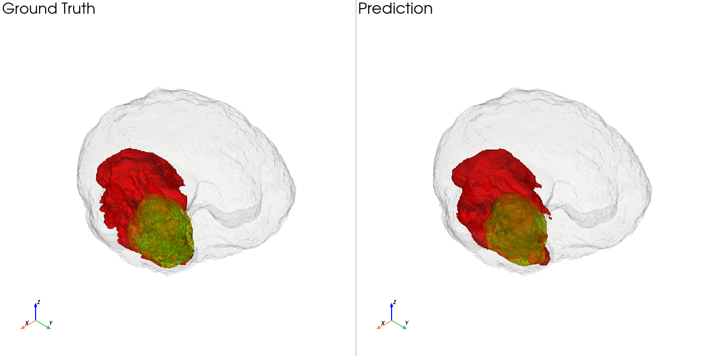
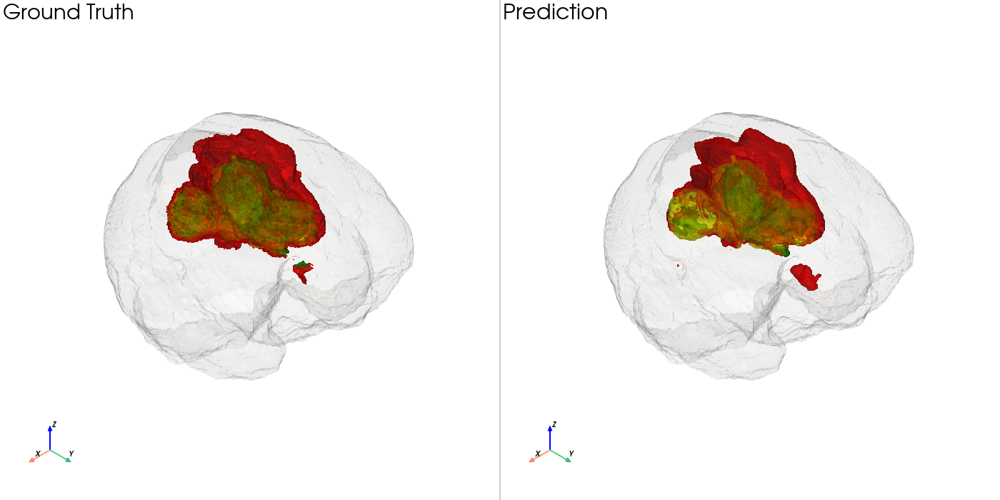
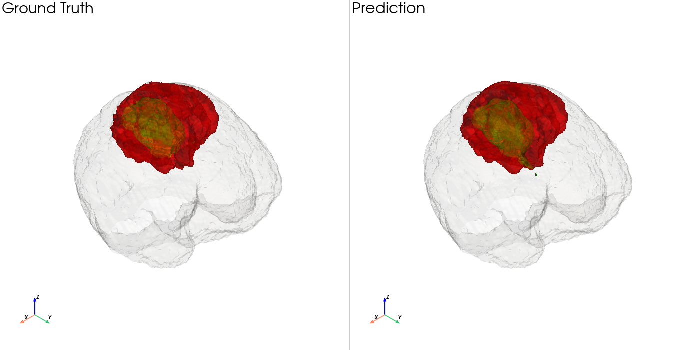

# BraTS Brain Tumor Segmentation with 3D U-Net

> 基于 PyTorch 的三维脑肿瘤 MRI 分割项目：从多模态医学影像预处理、3D U-Net 训练，到整脑滑窗推理、Dice / HD95 评估与三维可视化。

## 项目概述

本项目使用 [Medical Segmentation Decathlon (MSD) — Task01_BrainTumour](http://medicaldecathlon.com/) 数据集，对多模态脑部 MRI 进行体素级肿瘤分割。模型为从零训练的轻量级 **3D U-Net**，输入四种 MRI 模态，输出背景和三种肿瘤组织类别。

项目为**学习与研究演示**，不用于临床诊断或治疗决策。

### 主要功能

- 四通道 MRI 读取、非背景区域逐模态 Z-score 归一化
- 3D U-Net 编码器 / 解码器与 Skip Connection
- 64³ 训练 Patch，70% 肿瘤区域优先采样
- 患者级训练 / 验证集划分，避免同一患者同时参与训练与验证
- 整脑滑动窗口预测及重叠区域 Logits 平均
- 自动保存最佳模型及断点续训检查点
- WT / TC / ET Dice、HD95 指标与 3D 可视化

## 模型架构

```text
Input MRI: (B, 4, D, H, W)
         │
    DoubleConv3D → 16 channels
         │  ────────────────────────────┐
    MaxPool + DoubleConv → 32           │
         │  ───────────────────────┐    │
    MaxPool + DoubleConv → 64      │    │
         │  ────────────────┐      │    │
    MaxPool + DoubleConv → 128     │    │
         │                        │    │
    Upsample + Skip(64) → 64  ◀────┘    │
         │                             │
    Upsample + Skip(32) → 32  ◀─────────┘ (32-channel skip)
         │
    Upsample + Skip(16) → 16  ◀── first encoder features
         │
    1×1×1 Conv → 4-class logits
```

每个 `DoubleConv3D` 包含两组 `Conv3d + InstanceNorm3d + ReLU`。具体实现见 [src/unet3d.py](src/unet3d.py)。

## 数据集与预处理

使用 **MSD Task01_BrainTumour**，共 **484 例带分割标签的 MRI**：

- MRI 文件：`imagesTr/BRATS_XXX.nii.gz`，原始形状为 `(240, 240, 155, 4)`
- 标签文件：`labelsTr/BRATS_XXX.nii.gz`，形状为 `(240, 240, 155)`
- 标签值：`0` 背景、`1` 水肿、`2` 非增强肿瘤、`3` 增强肿瘤

读取时把通道从最后一维移至第一维：`(H, W, D, 4) → (4, H, W, D)`。每个 MRI 通道仅使用非零体素计算均值和标准差。

患者级划分采用 `torch.randperm`、随机种子 `42`：**387 例训练 / 97 例验证**。训练时裁剪随机 `64×64×64` Patch（70% 概率围绕肿瘤体素）；验证时处理完整体积。

数据下载（原始数据不纳入本仓库）：
```bash
wget -c https://msd-for-monai.s3-us-west-2.amazonaws.com/Task01_BrainTumour.tar
tar -xf Task01_BrainTumour.tar
```

使用数据前请核对来源及数据使用许可，不要将 MRI 原始数据直接提交到仓库。

## 实验设置

| 配置项 | 设置 |
| --- | --- |
| GPU | NVIDIA RTX 3090 24 GB |
| 框架 | PyTorch 2.4.0 + CUDA 12.1 |
| Optimizer | Adam |
| Learning rate | 0.001 |
| Loss | CrossEntropyLoss |
| Batch size | 1 |
| Epochs | 50 |
| Training patch | 64³ |
| Validation | 每 5 Epoch，全脑滑窗，stride 64 |
| Precision | 训练使用 CUDA AMP |

## 实验结果

### 全部 97 例验证患者

| 指标 | 最优成绩 |
| --- | ---: |
| **Whole Tumor (WT) Dice** | **0.8022** |

最优值来自 **Epoch 50 / 50**。这是该实验的**完整验证集 WT Dice**，不是独立测试集结果。该次训练尚未对全部 97 例统计 TC、ET 或 HD95。

### 3 例验证患者示例

从固定验证集抽取 `BRATS_001`、`BRATS_142`、`BRATS_446` 做进一步评估及可视化：

| 患者 | WT Dice ↑ | TC Dice ↑ | ET Dice ↑ |
| --- | ---: | ---: | ---: |
| BRATS_001 | 0.8737 | 0.9478 | 0.8551 |
| BRATS_142 | 0.9494 | 0.9399 | 0.9179 |
| BRATS_446 | 0.9514 | 0.9491 | 0.8891 |
| **3 例均值** | **0.9248** | **0.9456** | **0.8874** |

| 患者 | WT HD95 ↓ | TC HD95 ↓ | ET HD95 ↓ |
| --- | ---: | ---: | ---: |
| BRATS_001 | 4.3589 mm | 2.8284 mm | 1.7321 mm |
| BRATS_142 | 2.2361 mm | 3.0000 mm | 1.4142 mm |
| BRATS_446 | 1.7321 mm | 2.0000 mm | 2.4495 mm |
| **3 例均值** | **2.7757 mm** | **2.6095 mm** | **1.8653 mm** |

区域定义：**WT = {1,2,3}；TC = {2,3}；ET = {3}**。

> **结果解释：** 三例是可视化示例，不能用其均值代替全部 97 例的验证成绩。HD95 采用仓库自定义实现（双向表面距离合并后取第 95 百分位），不保证与 BraTS 官方评价工具的 HD95 定义完全一致；不同实现结果不应直接混为同一基准。

## 3D 分割可视化

使用 PyVista 同时展示真实分割（Ground Truth）与模型预测（Prediction）。图像放在 `docs/images/` 下，可直接在 GitHub README 中展示。







## 快速开始

**1. 安装环境**

建议 Python 3.11；请先按照自己的 GPU / CUDA 环境安装 [PyTorch](https://pytorch.org/get-started/locally/)，再执行：

```bash
pip install -r requirements.txt
```

**2. 准备数据与模型**

```text
brats-3d-unet/
├── src/                         # 网络、训练、评估、可视化源码
├── docs/images/                 # 3D 对比图（展示素材）
├── data/Task01_BrainTumour/     # 数据集（不提交到 Git）
│   ├── imagesTr/
│   └── labelsTr/
├── checkpoints/best.pth         # 最佳权重（不提交到 Git）
└── requirements.txt
```

**3. 训练**

`src/train.py` 默认使用云端数据路径 `/hy-tmp/Task01_BrainTumour`；在其他环境可通过 `BRATS_DATA_ROOT` 指定数据目录：

```bash
BRATS_DATA_ROOT=/path/to/Task01_BrainTumour BRATS_EPOCHS=50 BRATS_VAL_EVERY=5 python src/train.py
```

训练时保存 `best.pth`（最佳验证 WT Dice）与 `last.pth`（模型 + 优化器等训练状态），在云端默认写入 `/root/brats-checkpoints/`。请自行备份权重，释放云实例前尤其要确认文件已转存。

**4. 评估与可视化**

在项目根目录准备好 `checkpoints/best.pth` 和 `data/Task01_BrainTumour/` 后：

```bash
python src/evaluate.py
python src/evaluate_hd95.py
python src/visualize_compare.py
```

- `evaluate.py`：读取本地提供的病例，计算 WT / TC / ET Dice 并保存 `outputs/evaluation/*_pred.npy`
- `evaluate_hd95.py`：使用预测文件和对应的标签计算三个区域的 HD95
- `visualize_compare.py`：使用 PyVista 显示及导出单个病例的 GT vs Prediction 三维对比图

注意：当前本地评估脚本默认扫描 `data/Task01_BrainTumour/imagesTr/` 下的病例；如果只下载了三例，就只会评估三例，不是全部 97 例的评估复现。

## 项目结构与后续方向

- `src/unet3d.py`：3D U-Net 网络结构
- `src/msd_dataset.py`：MSD 数据读取和 Patch 采样
- `src/train.py`：训练、定期整脑验证与检查点
- `src/sliding_window.py`：完整 MRI 滑窗推理
- `src/evaluate.py`、`src/evaluate_hd95.py`：分割指标
- `src/visualize_compare.py`：三维对比可视化
- `src/brats_dataset.py`、`src/predict.py` 等：早期单患者 Demo

后续可尝试 CE + Dice Loss、学习率调度、更密集的滑窗重叠、独立测试集以及覆盖完整验证集的 TC / ET / HD95 评估。

---

**Disclaimer:** Educational / research use only. Not validated for clinical use.
